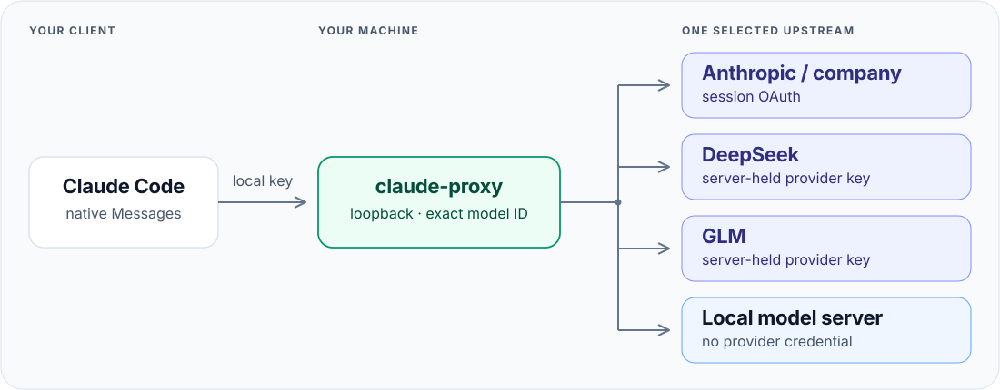

# claude-proxy

### One local endpoint. Multiple native model providers.

Claude Code uses one API base URL. Switching providers usually means changing
that connection or adding a gateway that translates protocols.

**claude-proxy keeps the connection fixed and the protocol native.**
It maps each exact model ID to a configured upstream and forwards the original
request and response stream.

- **Native protocol.** No body translation, model aliases, retries or fallback.
- **Separate credentials.** Session OAuth for Claude. Server-held keys for other providers.
- **Local by design.** One Go binary, loopback only, manually started.

Choose models directly or use [claude-model-router](https://github.com/alexei-led/claude-router)
with a mixed profile. The router chooses the model. The proxy transports the request.

> **Experimental:** see the scoped [live results](docs/verification.md#live-acceptance).
> OAuth refresh, billing and untested provider combinations remain unverified.
> Start with non-sensitive data.

## Explore

[Configure Claude Code →](docs/integration.md) ·
[Configuration reference](docs/configuration.md) ·
[Architecture](docs/design.md) ·
[Tests and readiness](docs/verification.md)

[Build and contribute](CONTRIBUTING.md) · [MIT license](LICENSE)
